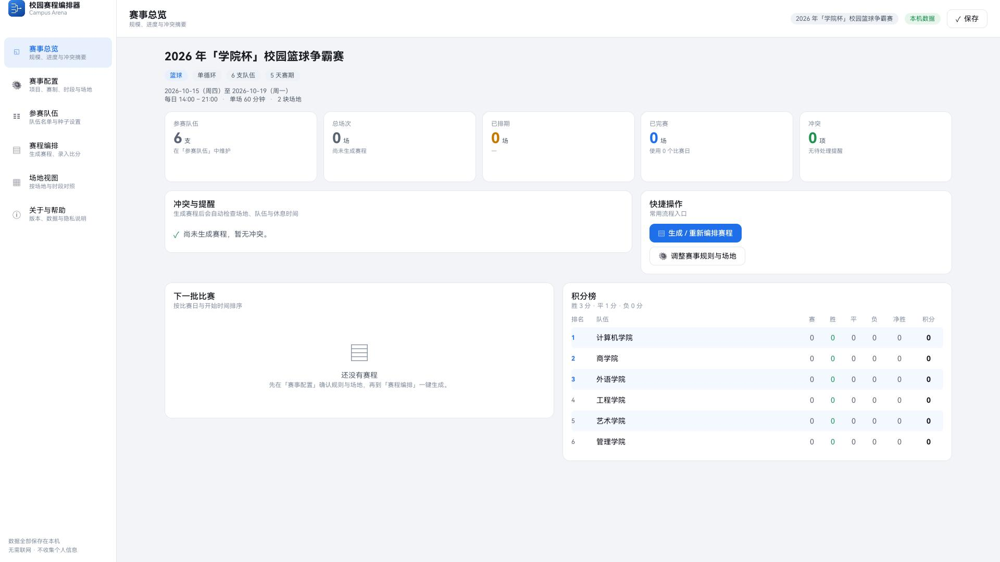
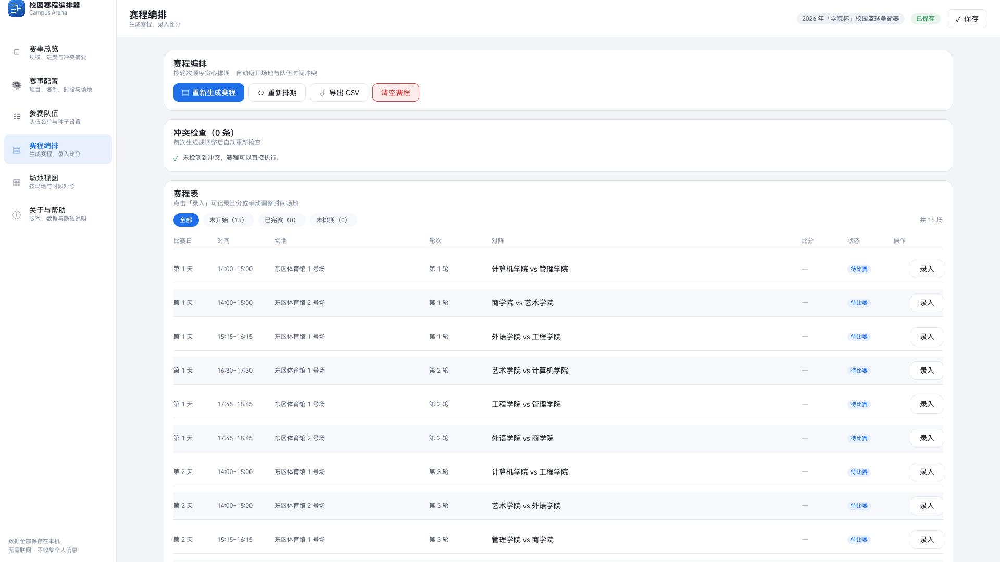
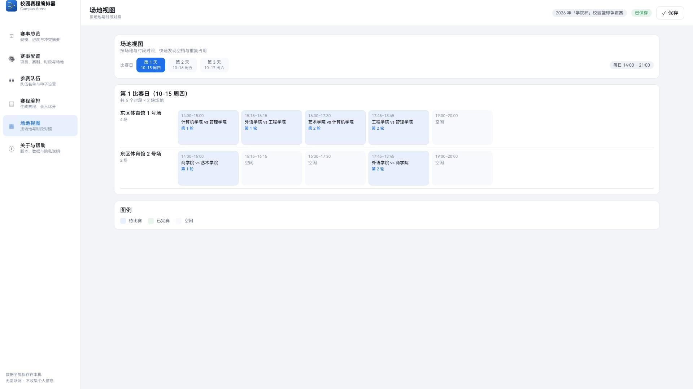
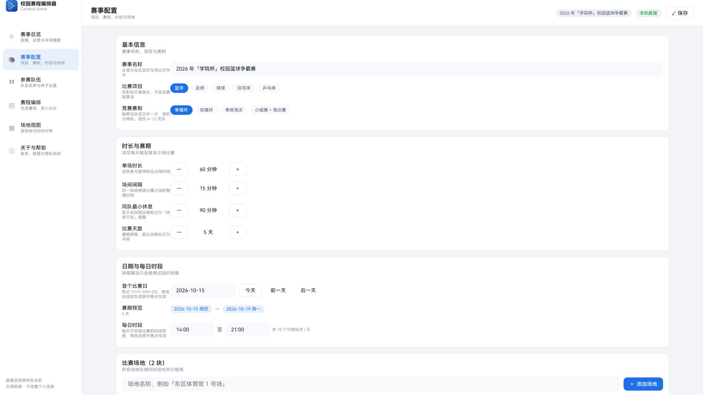
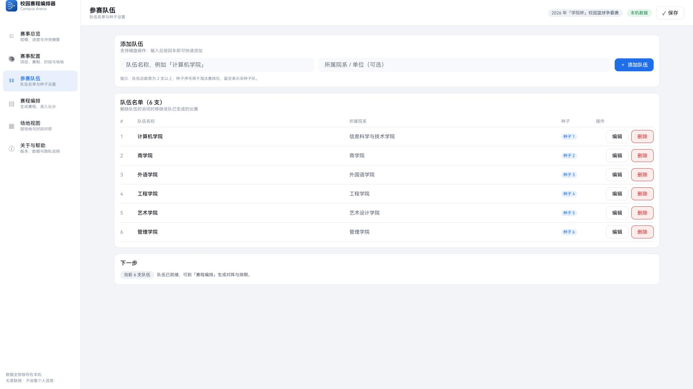

# 校园赛程编排器 · Campus Arena

> 为鸿蒙电脑打造的完全离线校园赛事赛程编排工具：自动生成对阵，避开场地与队伍冲突，并支持手动调整、积分榜和 CSV 导出。

HarmonyOS NEXT · ArkTS / ArkUI · Stage 模型 · API 17 · 完全离线

[在线界面预览](https://hahaaa520.github.io/campus-arena/) · [快速开始](#快速开始) · [开发与构建文档](docs/DEVELOPMENT.md)



## 把手工排表变成可执行赛程

Campus Arena 面向校园篮球赛、足球赛、羽毛球赛等赛事组织场景，集中解决三个问题：

1. **对阵编排繁琐**：录入队伍和赛制后，自动生成完整对阵，处理奇数队轮空、种子排位和交叉淘汰席位。
2. **时间场地容易冲突**：自动排期同时检查场地占用、队伍时间重叠和同队最小休息间隔。
3. **局部调整牵一发动全身**：手动调整的场次可以锁定，重新排期时保持不变；冲突按“必须修复”和“建议调整”分级展示。

## 界面预览

| 赛程编排 | 场地视图 |
| --- | --- |
|  |  |

| 赛事配置 | 参赛队伍 |
| --- | --- |
|  |  |

> 在线预览为静态界面与截图展示；完整应用需要在 HarmonyOS 开发或设备环境中运行。

## 核心功能

- **四种赛制**：单循环、双循环、单败淘汰、小组赛＋淘汰赛。
- **自动排期**：按比赛日、每日时段、场地和单场时长生成可执行赛程。
- **冲突检测**：识别场地重复占用、同队同时出场、未排期、时段越界和休息不足。
- **手动调整与锁定**：调整单场比赛后可锁定，重新排期不覆盖人工结果。
- **比分与晋级**：录入比分，自动更新积分榜，并将淘汰赛胜者传入下一轮。
- **CSV 导出**：带 UTF-8 BOM，可直接用 Excel 打开。
- **大屏与键鼠适配**：宽窗口多栏布局、响应式断点、悬停反馈和键盘走焦。
- **本地数据与隐私**：不申请网络权限，不收集个人信息，并提供应用内隐私说明和本机数据清除入口。

## 快速开始

### 环境要求

- Windows
- DevEco Studio 5.0.13.240
- HarmonyOS SDK API 17（5.0.5.165）
- 项目放在纯 ASCII 路径下，避免 hvigor 与资源编译器的中文路径问题

如果 DevEco Studio 未安装在默认目录，请先调整 `tools/build.cmd` 中的 `DEVECO_ROOT`。

### 克隆、构建与测试

在 Windows CMD 中执行：

```cmd
git clone https://github.com/hahaaa520/campus-arena.git
cd campus-arena

REM 编译并生成 HAP
tools\build.cmd assembleHap --no-daemon

REM 运行核心算法测试
tools\logic-test\run-tests.cmd
```

也可以用 DevEco Studio 打开项目，从 `entry/src/main/ets/pages/Index.ets` 进入界面预览。

不要直接用 `hvigorw.bat` 构建；项目通过 `tools/build.cmd` 复用 DevEco Studio 内置的 hvigor、Node 和 JBR。完整构建、打包和验证说明见 [开发与构建文档](docs/DEVELOPMENT.md)。

## 技术亮点

- **纯函数核心算法**：对阵生成、排期、冲突检测、积分与导出集中在 `Scheduler.ets`，不依赖 ArkUI。
- **针对真实源码测试**：测试脚本对实际模型源码做类型擦除后执行，而不是测试一份重写算法；当前包含 50 项核心算法检查。
- **完全离线**：应用数据保存在本机 Preferences，不依赖服务端。
- **面向鸿蒙电脑设计**：支持 2in1、平板和手机设备类型，针对大屏、多窗口、鼠标和键盘优化。

## 项目结构

```text
AppScope/                       应用配置与图标
entry/src/main/ets/
├── model/                     数据模型、核心算法与本地持久化
├── pages/Index.ets            主框架与入口页
├── view/                      6 个页面视图
├── common/                    主题、组件与 CSV 导出
└── entryability/              应用入口
tools/
├── build.cmd                  构建入口
├── logic-test/                核心算法测试
├── signing/                   发布签名工具与说明
└── verify-artifacts.py        构建产物检查
docs/
├── shots/                     界面截图
└── DEVELOPMENT.md             算法、构建、验证与发布说明
```

## 当前验证边界

- 仓库提供 ArkTS 编译、HAP／APP 打包、核心算法和产物规格检查脚本。
- **界面渲染与交互尚未完成真机／模拟器验收**，软件测试不等同于真机效果验证。
- 当前固定浅色主题；批量 CSV 导入和淘汰赛季军赛尚未实现。
- 上架前需替换 `AboutView.ets` 中的占位联系方式，并使用自己的 AGC 证书与 Profile。

更多限制和发布注意事项见 [开发与构建文档](docs/DEVELOPMENT.md)。
